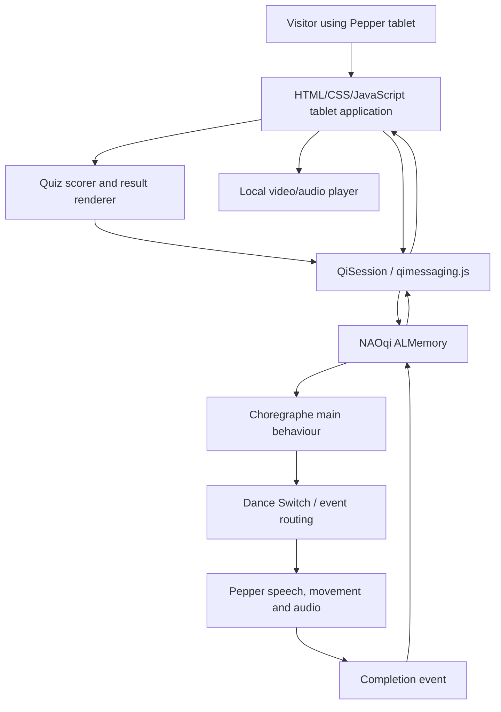

**Project:** Pepper Freshers / Hull Robotics Society interactive demonstration  
**Repository:** [reeceherbert887/Pepper_Stuff](https://github.com/reeceherbert887/Pepper_Stuff)  
**Project directory:** [`Pepper-Freshers`](https://github.com/reeceherbert887/Pepper_Stuff/tree/main/Pepper-Freshers)  
**Local directory:** `~/repos/Pepper_Stuff/Pepper-Freshers`  
**Documentation review:** 8 October 2026  
**Scope:** Source-code-based technical guide; not a record of a successful hardware test.  
**Source version:** Public `main` branch at review time; an individual commit was **not** pinned.

---

## 1. Project overview

**Pepper Freshers** is an interactive demonstration application for the SoftBank Robotics **Pepper** humanoid robot, designed around a visitor-facing tablet interface and physical robot behaviours. It introduces attendees to the Hull Robotics Society and robotics concepts, provides a five-question robotics personality quiz, and allows visitors to select demonstrations.

The application combines two execution environments:

1. **Pepper's tablet:** A web interface built with HTML, CSS and JavaScript. This displays the quiz, results, QR code, project menus, video content and activity status.
2. **Pepper's NAOqi / Choregraphe behaviour:** A Choregraphe project containing Python boxes, event listeners, motion timelines and media/robot-service calls that make Pepper speak, dance and perform activities.

The link between those environments is principally **`ALMemory`**, reached from the tablet through the NAOqi `qimessaging.js` / `QiSession` JavaScript interface.

### Intended audience and use

The project is suited to supervised university society demonstrations, freshers/refreshers events, exhibitions and outreach sessions. A visitor can operate the tablet while a trained operator supervises Pepper's movement and controls the Choregraphe behaviour.

### What the reviewed source implements

- A **five-question** personality quiz with six possible results.
- A **result screen** showing a Robotics Society QR code and controls to restart or continue.
- A **three-option project menu**: Pepper Dance, Photo Opportunity, Refreshers.
- **Three dance selections**: Dance of the Knights, Walk This Way, Hungary.
- **Three Refreshers selections**: Bees, Surprise, Speech.
- **Photo Opportunity** selection, routed to the robot-side Choregraphe behaviour.
- Browser-only preview modes for some content, so parts of the tablet UI can be tested without Pepper.
- Choregraphe event handling to route selected actions and return the tablet to dance/Refreshers menus on completion.

**Important:** Presence in the repository does not mean every animation or transition has been validated on the physical robot. See §14–§16 for observed limitations and a test plan.

---

## 2. Technology stack

| Component | Technology | Function |
|---|---|---|
| Physical robot | SoftBank Robotics Pepper | Motors, head/arms/body, speaker and built-in tablet |
| Behaviour editor/runtime | Choregraphe / NAOqi | Constructs, loads and runs behaviours on Pepper |
| Robot scripting | Choregraphe Python boxes (legacy Python 2-style code) | Handles events, speech, motion routing and completion |
| Robot APIs | `ALMemory`, `ALTextToSpeech`, `ALTabletService`, `ALLeds`, etc. | Communication, speech, tablet control, physical effects |
| Tablet structure | HTML | All eight display screens |
| Tablet design | CSS | Layout, large buttons, colour scheme, video presentation |
| Tablet interactions | JavaScript | Quiz scoring, navigation, video handling and event publishing |
| Tablet-to-robot bridge | `/libs/qimessaging/2/qimessaging.js` with `QiSession` | Access to NAOqi services from Pepper's webview |
| Audio/media | `.ogg`, `.mp3`, `.mp4` | Dance soundtracks and Refreshers videos |
| Robot motion assets | Choregraphe timelines, `.pmt`, Python trajectory resources | Pre-defined movements and movement playback |
| Source control | Git / GitHub | Version control and distributing source |

The relevant Choregraphe files contain legacy syntax such as `except Exception, error`. **Do not run those box scripts directly with your Ubuntu Python 3 interpreter.** They are intended for the compatible Choregraphe/NAOqi runtime.

This project does **not** use ROS, Node-RED, MQTT or SQLite for the reviewed Freshers application.

---

## 3. Repository structure and file roles

The following is a **source-backed partial tree**, not an invented exhaustive directory listing. Some entries were directly opened; others are resource paths declared in `Pepper-Freshers.pml` and should be checked for existence when preparing the robot.

```text
Pepper_Stuff/
└── Pepper-Freshers/
    ├── Pepper-Freshers.pml             # Choregraphe package/project definition
    ├── manifest.xml                    # Manifest and principal behaviour
    ├── behavior_1/
    │   ├── behavior.xar                # Main active Freshers behaviour
    │   ├── 02_Hungary.ogg              # Referenced soundtrack
    │   ├── kishitachinoodori.ogg       # Referenced soundtrack
    │   ├── walk_this_way.ogg           # Referenced soundtrack
    │   ├── Hungarian_trajectory.pmt    # Referenced motion resource
    │   ├── DTHungryTrajectoryFileName.py
    │   ├── DTTrajectoryFileName.py
    │   └── ... other motion/audio assets
    ├── refreshers/
    │   ├── behavior.xar                # Separate Refreshers Choregraphe behaviour
    │   └── ... referenced Refreshers assets
    ├── behavior.xar                    # Additional legacy/root behaviour
    ├── html/
    │   ├── index.html                  # Tablet screens and action buttons
    │   ├── script.js                   # Quiz, navigation, media and events
    │   ├── style.css                   # Tablet styling, video layout
    │   ├── robsoc-qr.png               # QR image
    │   └── assets/
    │       ├── Bees_Gees.mp4           # Referenced Refreshers video
    │       └── Rick Roll Link.mp4      # Referenced Refreshers video
    ├── translations/                   # Language files declared in .pml
    └── ... additional declared files
```

### Important distinctions

**`Pepper-Freshers.pml`** describes the package, its behaviours and its resources. It currently declares **three** behaviour descriptions: `behavior_1/behavior.xar`, `refreshers/behavior.xar` and top-level `behavior.xar`. These are not interchangeable.

**`manifest.xml`** names `behavior_1` as the package's **user-requestable interactive behaviour**. Thus, `behavior_1/behavior.xar` is the primary entry point to document and test. The manifest currently uses package version `0.0.0` and the display name `Untitled`; these values would benefit from tidying if the project is distributed more widely.

**`behavior_1/behavior.xar`** contains the main event-driven workflow: show tablet app, subscribe to quiz results, listen for dance selections, choose Choregraphe branches and send completion events. It is a large XML file describing boxes and wires; edit the project in Choregraphe rather than treating its XML like ordinary Python source.

**`html/index.html`**, **`html/style.css`** and **`html/script.js`** form the UI. They are useful to edit directly in a text editor and to test independently in a desktop browser.

**Assets:** `.pml` lists media resources that must resolve correctly in the packaged robot application. Some source paths differ between `html/`, `behavior_1/` and `refreshers/`—case and path mismatches matter on Linux and in the robot webview.

---

## 4. System architecture



### Division of responsibilities

- **Tablet** decides *which menu to show*, computes quiz scores, shows QR/messages and starts HTML5 videos.
- **ALMemory** passes named events and values between tablet and Choregraphe. It is a communication mechanism, not a permanent database.
- **Choregraphe** decides *which physical robot behaviour to execute* and invokes robot APIs/animation timelines.
- **Return events** tell the tablet that a selected activity has finished and that it can return to the correct menu.

A displayed screen is **not proof** that the corresponding physical animation has started: the tablet and robot can experience separate failures.

---

## 5. Tablet interface and screen navigation

The HTML contains **eight** named screens. `showScreen(screenId)` hides elements with class `screen`, then applies `screen active` to the selected element.

| Screen ID | Purpose | Entry / exit |
|---|---|---|
| `start-screen` | Welcome; Start quiz | Starts the quiz |
| `quiz-screen` | Five multiple-choice questions | Automatically advances to result |
| `result-screen` | Personality result, description, QR | Restart or Next Section |
| `projects-screen` | Top-level demonstration choices | Dance, Photo Opportunity, Refreshers |
| `pepper-dance-screen` | Three dance buttons | Playing screen, or Back |
| `refreshers-screen` | Bees, Surprise, Speech | Playing screen, or Back |
| `photo-opportunity-screen` | Starts photo sequence | Playing screen, or Back |
| `dance-playing-screen` | Shared status/media display | Back to originating activity menu |

### Typical flow

```text
Welcome
   ↓ Start
Personality Quiz (five questions)
   ↓
Result + QR code
   ↓ Next Section
Choose a Project
   ├── Pepper Dance ── select track ── Playing ── Dance menu
   ├── Refreshers ──── select activity ── Playing/Video ── Refreshers menu
   └── Photo Opportunity ── Start ─── Playing / poses
```

The project menu uses direct `showScreen(...)` calls; the function `selectProject(projectName)` is present in JavaScript but is **not** the mechanism used by those three project-menu buttons.

### Appearance

The CSS defines a dark slate background, white card-style content panels, cyan-blue accent buttons, wide touch-friendly controls and a special enlarged layout for Refreshers video playback. The page uses a single screen at a time and disables body scrolling; screen-size testing on actual Pepper hardware is important.

The HTML references `style.css?v=10` and `script.js?v=10`. The `?v=10` query string is a simple cache-busting mechanism. If a new file is deployed but the tablet appears to show an old version, ensure that the robot package was refreshed and consider updating the query version.

---

## 6. Robotics personality quiz

The quiz is implemented entirely in `html/script.js` using a `questions` array, `scores` object, `currentQuestion` index and a `results` lookup.

### Questions

1. **What sounds most interesting?** Choices include building a robot, programming AI, electronics and solving real-world problems.
2. **Which robot would you rather build?** Delivery robot, rescue robot, drone or humanoid robot.
3. **What would you rather learn?** ROS2, Computer Vision, Embedded Systems or Machine Learning.
4. **Favourite sci-fi robot?** R2-D2, WALL-E, TARS or Data.
5. **You have £100 and a weekend. What do you build?** Robot car, smart home system, AI assistant or drone.

Each selected answer contributes **one point** to an associated category.

### Result categories

| Internal category | Displayed result |
|---|---|
| `ai` | AI Researcher |
| `rescue` | Rescue Robotics Engineer |
| `embedded` | Embedded Systems Engineer |
| `autonomous` | Autonomous Systems Engineer |
| `vision` | Computer Vision Specialist |
| `drone` | Drone Specialist |

### How scoring works

1. `startQuiz()` resets the question index and score dictionary.
2. `showQuestion()` fills the question text and generates answer buttons with `data-type` values.
3. `selectAnswer(type)` increments the corresponding score and advances the index.
4. After five selections, `showResult()` searches for the highest-scoring category.
5. The result title and description are inserted into the result screen.
6. The full result sentence is passed to `sendResultToPepper(...)` for optional spoken feedback.

**Tie behaviour:** The current implementation updates the winning category only for a **strictly greater** score. There is no documented, explicitly designed tie-breaker. On a tie it keeps whichever tied key is encountered first during object enumeration (typically influenced by answer insertion order). This is fine for an informal activity but should be made explicit if predictable, fair scoring is required.

**Data handling:** No quiz results are written to an application database or submitted to a third-party API by the reviewed source. Results exist in browser memory and may be relayed within Pepper via `ALMemory`.

### Quiz-to-robot speech

The `PepperFreshers/Result` event contains a text sentence, such as:

```text
You are a AI Researcher. You enjoy solving complex problems using machine learning and intelligent systems.
```

The message wording above reflects the direct concatenation in source and can produce a grammatical issue (`a AI Researcher` instead of `an AI Researcher`). This is cosmetic but worth correcting in a later UI revision.

The Choregraphe `Python Script` box subscribes to this event and calls `ALTextToSpeech.say(...)` with the supplied text.

---

## 7. ALMemory communication and event contract

The integration depends on **exact event names and payload values**. Altering either side without the other will break routing.

### Events used by the application

| ALMemory event | Direction | Payload / purpose |
|---|---|---|
| `PepperFreshers/Result` | Tablet → robot | Text of the selected quiz result; Pepper says it |
| `PepperFreshers/DanceSelected` | Tablet → robot | Identifier for a dance, Refreshers activity or photo mode |
| `PepperFreshers/ReturnToDancePage` | Robot → tablet | Completion signal; display dance selection screen |
| `PepperFreshers/ReturnToRefreshersPage` | Robot → tablet | Completion signal; display Refreshers selection screen |

### Selection values

| Button / action | Event value | Expected Choregraphe router branch |
|---|---|---|
| Dance of the Knights | `dance_knights` | `dance_knights` |
| Walk This Way | `walk_this_way` | `walk_this_way` |
| Hungary | `02_Hungary` | converted to `02_hungary`, routes to `hungarian` |
| Bees | `Bees` | converted to `bees` |
| Surprise | `Surprise` | converted to `surprise` |
| Speech | `Speech` | converted to `speech` |
| Photo Opportunity | `photo_opp` | `photo_opp` |

The JavaScript publishes selection events via:

```javascript
QiSession(function (session) {
  session.service("ALMemory").then(function (memory) {
    memory.raiseEvent("PepperFreshers/DanceSelected", danceName);
  });
});
```

*Representative excerpt for explanation; the source wraps this behaviour in `raisePepperEvent(...)`.*

### How Choregraphe receives the selection

The main `.xar` contains a subscription box named **`PepperFreshers/DanceSelected`**, configured for that event. It activates a Python box named **`Dance Switch`**, which reads the latest value from `ALMemory`, converts it to lowercase, and calls the corresponding named output.

The router accepts the aliases `02_hungary`, `hungarian` and `hungary` for the Hungarian dance. Unknown or empty selections are logged rather than sent to a known movement branch.

**Technical consideration:** The switch uses `memory.getData("PepperFreshers/DanceSelected")` rather than directly consuming the `onEvent` payload. This works as a simple shared-memory design but couples the switch to mutable global event state; if several commands arrive rapidly, the value used could differ from the event that triggered the box. Use the event payload directly if revising the routing design.

### Completed activity → tablet

Selected Choregraphe boxes raise `PepperFreshers/ReturnToDancePage` or `PepperFreshers/ReturnToRefreshersPage` to restore the relevant selection menu. On page load, `setupPepperReturnEvents()` subscribes to those events and calls `showScreen(...)`.

Some soundtrack-handling sections in the main `.xar` raise the dance return event **twice** in immediate succession. That is unnecessary and should be reviewed, particularly if completion handling later gains side effects.

---

## 8. Pepper Dance functionality

The dance screen contains the following choices:

| Visible label | Internal value | Referenced local audio |
|---|---|---|
| Dance of the Knights | `dance_knights` | `behavior_1/kishitachinoodori.ogg` |
| Walk This Way | `walk_this_way` | `behavior_1/walk_this_way.ogg` |
| Hungary | `02_Hungary` | `behavior_1/02_Hungary.ogg` |

The source contains substantial Choregraphe dance templates/timelines and motion resource references, including `.pmt` trajectory files. These are **predefined motions**, not dynamically generated dancing or machine-learning behaviours.

### On Pepper

1. The visitor taps a dance choice.
2. `selectDance()` shows the shared playing screen.
3. `QiSession` is detected; the code raises `PepperFreshers/DanceSelected`.
4. The main Choregraphe behaviour receives and routes the selection.
5. Choregraphe performs the selected robot behaviour.
6. Completion code may raise a return event to show the dance menu again.

The robot—not the HTML5 `<audio>` element—is responsible for performing actual robot movement.

### In a desktop browser

`QiSession` is normally unavailable. `selectDance()` therefore calls `playLocalDanceAudio(...)`, which constructs an `Audio(...)` element using the relative `../behavior_1/...` paths, and returns to the dance menu when playback ends.

This makes a desktop demonstration possible **without** making the robot move. The sound file must exist at the resolved relative URL and must be playable by the local browser.

---

## 9. Refreshers functionality

The Refreshers section contains three activities:

| Activity | Tablet presentation | Robot-side control |
|---|---|---|
| Bees | Video `html/assets/Bees_Gees.mp4` | `DanceSelected` value `Bees` |
| Surprise | Video `html/assets/Rick Roll Link.mp4` | `DanceSelected` value `Surprise` |
| Speech | On-screen Robotics Society message (intended) | `DanceSelected` value `Speech` |

### Bees / Surprise

`selectRefreshers()` first enters the shared playing screen, then `playLocalRefreshers()` creates a video element with `controls`, `autoplay` and `playsinline` attributes. It also invokes playback programmatically. If the browser blocks autoplay, it logs an error and the visitor may need to press Play.

For videos, the CSS activates a `refreshers-video-mode` class which enlarges the media display. The regular logo/message is intentionally hidden in this mode. At the end of video playback, the JavaScript clears local media and returns to `refreshers-screen`.

On Pepper, **the same selection also generates an `ALMemory` event**, so the physical behaviour can run alongside the tablet video. The code does not guarantee frame-accurate synchronisation between video and robot motion.

### Speech

The Speech branch is designed to show the Robotics Society message and cause Pepper to perform the associated speech/animation branch.

**Source-level issue:** In `playLocalRefreshers()`, the non-video branch calls `restorePlayingScreen()`. That function sets the shared playing screen to `className = "screen"`, which makes it hidden under the current CSS. The function then inserts the speech message into that hidden screen without reactivating it. The Speech message may therefore disappear. A repair is recommended in §14; this document does **not** modify the original code.

### Returning to the menu

Successful physical behaviour completion can raise `PepperFreshers/ReturnToRefreshersPage`. The tablet listens for this event and navigates to the Refreshers selection screen. Independently, completion of the HTML5 video can navigate back even if the robot behaviour has not finished; that is an asynchronous edge case to test.

---

## 10. Photo Opportunity

The Photo Opportunity screen offers a **Start** action. JavaScript calls `startPhotoOpportunity()`, displays a message stating that Pepper will cycle through poses approximately every **15–20 seconds**, and publishes `PepperFreshers/DanceSelected` with value `photo_opp` on the real tablet.

The Choregraphe router contains a corresponding `photo_opp` output, and the main behaviour includes a photo-initialisation box and linked movement sequence.

In browser-only mode, no physical motion occurs. The screen displays a description of what would happen.

**Important implementation distinction:** The JavaScript declares and clears `photoOpportunityTimer`, but the reviewed script does **not** schedule repeated pose changes with that timer. The 15–20-second interval appears in the user-visible message; it should **not** be treated as a verified measured interval of actual robot pose changes without testing the Choregraphe sequence.

Recommended checks: confirm which poses are used, the measured repeat interval, whether the sequence loops indefinitely, and whether stopping/navigating away reliably cancels the motion.

---

## 11. Behaviour lifecycle inside Choregraphe

### Startup

The principal `Show App` box acquires `ALTabletService`, calls `loadApplication(...)` using the package identifier and then `showWebview()`. It has success and failure outputs.

Separately, Python and event-subscription boxes initialise listeners for quiz results and activity selections. Startup wiring is held in the XML diagram rather than in a single ordinary Python `main()` function.

### Quiz result handling

The Python listener subscribes to `PepperFreshers/Result`. Upon receipt it calls `ALTextToSpeech.say(...)`. It attempts to unsubscribe during cleanup.

### Behaviour selection

The `PepperFreshers/DanceSelected` subscription triggers `Dance Switch`, which selects the appropriate Choregraphe output. Dance templates and movement boxes then handle the action.

### Completion

Movement/music boxes and dedicated boxes named **`Return to Dance Menu`** and **`Return to Refreshers Menu`** can raise the corresponding events for the tablet.

### Stop and unload

Choregraphe boxes provide `onStop` / `onUnload` hooks, but the tablet **Back** button is not, by itself, wired to those robot-side hooks. An operator must not interpret pressing Back as an emergency stop or proof that moving joints have halted.

---

## 12. Getting and opening the project on Ubuntu

### If the repository already exists locally

```bash
cd ~/repos/Pepper_Stuff

git status

git branch --show-current

cd Pepper-Freshers
ls -lah
```

### If a fresh clone is needed

```bash
mkdir -p ~/repos
cd ~/repos
git clone https://github.com/reeceherbert887/Pepper_Stuff.git
cd Pepper_Stuff/Pepper-Freshers
```

If `git status` shows local edits, do not run a pull or reset until those changes are committed or backed up.

### Inspect the project

```bash
find . -maxdepth 3 -type f | sort
```

Verify that these files are present:

```bash
ls -l Pepper-Freshers.pml manifest.xml \
  behavior_1/behavior.xar \
  html/index.html html/script.js html/style.css
```

You can also inspect `Pepper-Freshers.pml` and `manifest.xml` with a text editor to confirm that `behavior_1` is the intended entry point.

### Launch Choregraphe

On the Ubuntu setup used for this project, Choregraphe 2.5.5.5 has been installed under `/opt/Choregraphe`:

```bash
/opt/Choregraphe/choregraphe
```

In Choregraphe, use **File → Open Project** (menu wording may vary) and choose:

```text
~/repos/Pepper_Stuff/Pepper-Freshers/Pepper-Freshers.pml
```

Check the root behaviour and select the relevant `behavior_1` project behaviour. Verify that the project opens without missing-resource errors before connecting to Pepper.

### Connect to Pepper

1. Ensure the Ubuntu computer and Pepper are reachable over the intended network.
2. Identify Pepper's current IP address using the robot/network interface.
3. Connect to the robot from Choregraphe, confirming its actual model and installed NAOqi version.
4. Keep the robot in a clear, supervised operating area.
5. Install/deploy the Choregraphe application to the robot using your version's appropriate package workflow, if needed.
6. Start the **main user-requestable Freshers behaviour** and verify that the tablet webview loads.

There is no single universal shell command for deployment across all Pepper/NAOqi versions; use Choregraphe's package/behaviour controls and verify compatibility first.

---

## 13. Testing the tablet on Ubuntu without Pepper

The HTML/CSS/JS can be served from the repository directory:

```bash
cd ~/repos/Pepper_Stuff/Pepper-Freshers
python3 -m http.server 8000
```

Open:

```text
http://127.0.0.1:8000/html/index.html
```

Expected behaviour in a desktop browser:

- Welcome, quiz, result and menu navigation can run locally.
- Quiz answers are scored and shown in the browser.
- The QR image loads if its referenced file is present.
- Dance choices attempt **local audio playback**, without real movement.
- Refreshers choices attempt **local HTML5 video playback**.
- Photo Opportunity shows a simulation/preview message.
- JavaScript cannot connect to Pepper's `ALMemory` unless it is in an appropriately configured Pepper environment.

**Expected local-only warning:** The page loads `/libs/qimessaging/2/qimessaging.js`, which is generally served by Pepper rather than the Python HTTP server. A 404 for that script on localhost is expected; because the code checks whether `QiSession` exists, local preview mode can still work.

A local browser may block automatic media playback. Press Play manually, check the console, and ensure your paths and filename capitalisation match the repository.

Press **Ctrl+C** in the terminal to stop the local server.

### Inspect JavaScript errors

Open browser Developer Tools (**F12**) and review **Console** and **Network** for:

- Missing `robsoc-qr.png`.
- Missing or blocked media files.
- Script parse/runtime errors.
- Expected `qimessaging.js` absence on localhost.
- Failures to locate screen IDs used by `showScreen()`.

Local testing verifies the web UI only; it cannot validate robot joint safety, NAOqi calls or Choregraphe wiring.

---

## 14. Code review findings and known limitations

These findings are based on the reviewed public source, not a hardware test. Priorities reflect reliability/safety impact.

| Priority | Finding | Evidence / consequence | Suggested action |
|---|---|---|---|
| **High** | Back button stops local media but does **not** send a robot stop event | `setPlayingScreen()` calls `stopLocalMedia()` then changes screen | Implement and verify a robot-side cancel/stop protocol; do not assume navigation halts movement |
| **High** | Speech display can hide itself | `playLocalRefreshers()` calls `restorePlayingScreen()`, which removes `active` | Re-activate `dance-playing-screen` after restoring the non-video style |
| **Medium** | Potential stale events / concurrent actions | Selection uses shared `ALMemory.getData(...)`; menu events can arrive independently | Use direct event payloads and an explicit activity state machine |
| **Medium** | Video and robot completion are independent | HTML5 video `onended` and Choregraphe completion both navigate | Agree a single completion owner or check the active activity ID |
| **Medium** | Some return events emitted twice | Duplicated `ReturnToDancePage` raises in soundtrack handling | Emit exactly once and make return handlers idempotent |
| **Medium** | Photo interval not verified by JavaScript | 15–20 seconds is a display message; timer is not scheduled | Time the real sequence and document/adjust actual behaviour |
| **Medium** | No explicitly defined quiz tie policy | Strict `>` comparison keeps first equal-scoring result encountered | Specify a deterministic tie-breaker |
| **Low** | Result grammar can be incorrect | `"You are a " + result.title` | Use `a/an` correctly or rephrase |
| **Low** | Package metadata is generic | Manifest version `0.0.0`, name `Untitled` | Set project version/name before release |
| **Operational** | Legacy Python runtime requirements | `.xar` embeds Python 2-style syntax | Keep Choregraphe/NAOqi compatibility documented |
| **Operational** | Media asset paths/case are important | Paths distributed across `html`, `behavior_1`, `refreshers` | Audit actual files against `.pml` and test every selection |

### Minimal, illustrative Speech display correction

The following is a **suggestion, not an edit already made**. In the non-video `else` branch of `playLocalRefreshers()`, ensure the normal playing screen becomes visible again:

```javascript
else {
  restorePlayingScreen();
  showScreen("dance-playing-screen");

  preview.innerHTML =
    '<div class="refreshers-speech-container">' +
    '<h2>Want to thwart the robot uprising?</h2>' +
    '<p>Join the Robotics Society!</p>' +
    '</div>';
}
```

This addresses display state only. It does not guarantee the robot's Speech movement is functioning.

### Recommended design for a reliable Back/Cancel function

An eventual improvement should send an explicit **separate** event, e.g. `PepperFreshers/StopSelected`, when Back is pressed during a live activity. The Choregraphe side must subscribe to it, request cancellation of the *currently active* behaviour safely, and acknowledge completion. Only once acknowledged should the UI claim the activity has stopped.

**This event is a proposed interface, not a feature that currently exists in the reviewed project.** Never stop Pepper by indiscriminately disabling all motors or bypassing safety functions; preserve the robot's built-in limits and safety mechanisms.

---

## 15. Structured test plan

Use a checklist for every software update and every new robot deployment. Record `Pass`, `Fail` or `Not tested` and a brief observation.

| ID | Test | Expected result | Environment |
|---|---|---|---|
| T01 | Load `html/index.html` | Start screen renders without layout errors | Browser |
| T02 | Complete five quiz questions | Exactly five questions; valid result | Browser |
| T03 | Test a known tie | Result follows the implemented policy; behaviour recorded | Browser |
| T04 | Result QR | Image visible and scannable; destination verified | Browser / tablet |
| T05 | Restart button | Returns to Start; scores reset upon new quiz | Browser |
| T06 | Next Section button | Shows the three top-level choices | Browser |
| T07 | Dance: Knights | Correct screen/audio locally; motion on supervised robot test | Both |
| T08 | Dance: Walk This Way | Correct soundtrack and intended motion | Both |
| T09 | Dance: Hungary | `02_Hungary` routes to Hungarian branch | Both |
| T10 | End of each dance | Returns to dance menu without restarting application | Robot |
| T11 | Refreshers: Bees | Video displays/plays; corresponding robot branch triggers | Both |
| T12 | Refreshers: Surprise | Video displays/plays; corresponding robot branch triggers | Both |
| T13 | Refreshers: Speech | Message visible and Pepper performs intended speech | Both |
| T14 | Refreshers completion | Back/return restores Refreshers menu | Both |
| T15 | Photo Opportunity | Correct physical pose sequence; measured repeat interval | Robot |
| T16 | Back during dance | Safely cancels physical activity; **currently a gap** | Robot |
| T17 | Back during video | Local media stops; robot behaviour checked separately | Both |
| T18 | Rapid repeat selections | No overlap, unintended motion or stale navigation | Robot |
| T19 | Disconnect tablet during activity | Robot retains safe behaviour, operator can stop | Robot |
| T20 | Restart Choregraphe behaviour | Tablet and event subscriptions initialise cleanly | Robot |
| T21 | Missing media asset | Error reported; no unsafe or frozen behaviour | Both |
| T22 | Repeated event completion | Menu does not flicker or reopen stale screen | Robot |

### Test recording template

```text
Test ID:
Date / time:
Robot serial / model / NAOqi version:
Choregraphe version:
Git commit: (git rev-parse --short HEAD)
Operator:
Result: Pass / Fail / Not tested
Observed result:
Error message / log excerpt:
Follow-up action:
```

For consistency, test Pepper's physical motions at reduced operational risk: clear floor space, no nearby visitors, stable stance, reachable stop control and a designated supervisor.

---

## 16. Troubleshooting

### 16.1 Tablet stays blank

**Check:** Is the robot connected? Did the main behaviour actually start? Did the `Show App` box succeed? Can `ALTabletService` load the package? Is `html/index.html` included in project resources?

**Action:** Check Choregraphe logs and deployment status. The UI files may be valid while the robot fails to serve the application.

### 16.2 Quiz works but Pepper does not speak

**Check:** Does the page run on Pepper with `QiSession` available? Is the `PepperFreshers/Result` event subscribed? Can `ALTextToSpeech` speak normally?

**Action:** Verify the event spelling and the Choregraphe listener, rather than changing quiz scoring code.

### 16.3 Dance button responds but Pepper does not move

**Check:** Does the tablet raise `PepperFreshers/DanceSelected`? Is the event subscriber connected? Does the `Dance Switch` log the correct selection? Are the expected output and motion boxes wired? Are all assets present?

**Action:** Start with one low-risk branch on a supervised robot. Do not test several movements simultaneously to diagnose a single missing event.

### 16.4 Dance audio works on Ubuntu but not on Pepper

**Reason:** Browser preview audio and robot-side soundtrack playback are different mechanisms.

**Action:** Check Choregraphe sound resources and the robot-side audio box, not only the JavaScript `Audio(...)` code.

### 16.5 Refreshers video is black, cropped or silent

**Check:** Media exists in `html/assets`; filename spelling and case; tablet codec compatibility; autoplay restrictions; volume; video layout.

**Action:** Test both the desktop browser and physical tablet. A video playable by Firefox on Ubuntu is not necessarily playable by Pepper's webview.

### 16.6 Speech is selected but the screen disappears

**Likely code cause:** `restorePlayingScreen()` sets `className` to `screen` rather than an active screen, and the Speech branch does not call `showScreen()` afterward. See §14.

### 16.7 Back changes screens but the robot continues moving

**Expected from current JavaScript:** No robot-side stop request is sent. Stop the activity using verified robot/operator controls, then implement a separately tested cancellation protocol.

### 16.8 Program only runs correctly once

**Check:** Return events, duplicate completion signals, persistent subscribers, Choregraphe onStop/onUnload cleanup and whether a previous physical activity is still running.

**Action:** Inspect both Choregraphe and the tablet logs; add a single activity-state variable if needed before allowing retriggering.

### 16.9 Project opens but shows missing resources

**Check:** Paths in `Pepper-Freshers.pml` against real disk files:

```bash
cd ~/repos/Pepper_Stuff/Pepper-Freshers
find . -type f | sort
```

Remember that `Bees_Gees.mp4` exists in references under both `html/assets/` and `refreshers/`; one location does not automatically substitute for the other.

### 16.10 Choregraphe asks for NAO instead of Pepper

**Check:** Robot model selection and Choregraphe/NAOqi compatibility. Use an environment configured for Pepper, not merely a generic NAO simulator model. A successful display in an incompatible simulated robot does not validate Pepper animations.

---

## 17. Safe event-day operating procedure

### Before visitors arrive

1. Inspect robot hardware, motors, support surface and surroundings according to the institution's robot-use policy.
2. Confirm Pepper has adequate charge/power and a stable network connection.
3. Open the correct project in Choregraphe; check that media assets are present.
4. Check a quiz result, each tablet menu and one controlled movement.
5. Keep a trained supervisor beside the robot when any movement is enabled.
6. Verify how to stop the real robot promptly, independent of the HTML Back button.
7. Confirm the QR image leads to the intended current Robotics Society page.

### During the demonstration

- Visitors can operate the tablet, but the supervisor remains responsible for robot motion.
- Run one physical demonstration at a time.
- Do not permit touching or obstructing arms while dance trajectories are executing.
- Allow the activity to finish before reselecting where possible.
- Use the actual operator stop procedure if the physical robot behaves unexpectedly.

### After the demonstration

- Stop current behaviours using confirmed controls.
- Disconnect and close Choregraphe as appropriate.
- Note failed selections, media playback issues and unexpected return behaviour.
- Commit fixes separately with descriptive messages; preserve a tested release before the next public event.

---

## 18. Maintaining and extending the project

### Edit a quiz question

Edit the `questions` array in `html/script.js` and keep the `type` value consistent with an entry in `results`. Test the five-question flow and score calculation after any changes.

### Edit appearance

Change `html/style.css`. Pay attention to `.screen`, `.screen.active`, `#dance-playing-screen` and `.refreshers-video-mode` because changes there can alter visibility and touch controls.

### Add a new dance or activity

A new working option requires coordinated changes:

1. Add a button to `html/index.html`.
2. Make it call the correct JavaScript selection method with a stable identifier.
3. Add the new identifier to Choregraphe's routing logic and create its output.
4. Wire that output to the new behaviour.
5. Import and register necessary sound/motion/media resources in the Choregraphe package.
6. Decide whether the completion destination is the Dance or Refreshers menu.
7. Ensure the physical behaviour stops safely and cannot overlap with an existing one.
8. Test in local browser, then perform a supervised hardware test.

### Avoid fragile project merges

Do not simply concatenate entire `.pml` or `.xar` projects. Choregraphe XML contains identifiers, nested timelines, links and resource references; careless merges can produce duplicate IDs or broken wiring. Open both projects in Choregraphe, copy the intended boxes/behaviour, preserve resources and carefully reconnect the inputs/outputs.

### Useful Git commands

```bash
cd ~/repos/Pepper_Stuff

git status

git log --oneline --decorate --max-count=15

git log --date=iso --pretty=format:'%h %ad %s' -- Pepper-Freshers

git diff -- Pepper-Freshers
```

To see the exact revision you tested:

```bash
git rev-parse HEAD
```

Include that SHA in test records and future published documentation.

---

## 19. Recommended development priorities

**Priority 1 — Safety and reliability:** Give Back/Cancel a verified robot-side stop path; prevent overlapping behaviours; record operational stop instructions. These are prerequisites for reliably letting multiple visitors use the project.

**Priority 2 — Fix known UI and event issues:** Restore the Speech playing screen correctly; remove duplicate return-event raises; agree which component owns end-of-activity navigation; explicitly handle stale completion events.

**Priority 3 — Validate every feature on real hardware:** Test each dance, Bees, Surprise, Speech and Photo Opportunity. Record the observed result and any mismatch between the displayed message and actual robot motion.

**Priority 4 — Improve maintainability:** Update manifest metadata, separate activity identifiers from display names, add event/state logging, document dependencies and pin a known-working Git commit.

**Priority 5 — Outreach polish:** Check QR destinations, permissions to use music/video assets, accessibility of text and controls, and the behaviour of the tablet when a visitor interrupts or restarts the quiz.

---

## 20. Source references and verification notes

This documentation was produced by reviewing these **public GitHub sources** on 8 October 2026:

| Source | What was examined |
|---|---|
| [Repository root](https://github.com/reeceherbert887/Pepper_Stuff) | Repo and project directory context |
| [`Pepper-Freshers.pml`](https://raw.githubusercontent.com/reeceherbert887/Pepper_Stuff/main/Pepper-Freshers/Pepper-Freshers.pml) | Behaviours, resource list, file paths |
| [`manifest.xml`](https://raw.githubusercontent.com/reeceherbert887/Pepper_Stuff/main/Pepper-Freshers/manifest.xml) | Principal behaviour / package metadata |
| [`html/index.html`](https://raw.githubusercontent.com/reeceherbert887/Pepper_Stuff/main/Pepper-Freshers/html/index.html) | Screens, quiz and action buttons |
| [`html/style.css`](https://raw.githubusercontent.com/reeceherbert887/Pepper_Stuff/main/Pepper-Freshers/html/style.css) | General and video-mode styling |
| [`html/script.js`](https://raw.githubusercontent.com/reeceherbert887/Pepper_Stuff/main/Pepper-Freshers/html/script.js) | Quiz logic, event publishing, media, return handling |
| [`behavior_1/behavior.xar`](https://raw.githubusercontent.com/reeceherbert887/Pepper_Stuff/main/Pepper-Freshers/behavior_1/behavior.xar) | Main Choregraphe event wiring, routing and behaviour code |
| [`refreshers/behavior.xar`](https://raw.githubusercontent.com/reeceherbert887/Pepper_Stuff/main/Pepper-Freshers/refreshers/behavior.xar) | Additional bundled Choregraphe behaviour |
| [Top-level `behavior.xar`](https://raw.githubusercontent.com/reeceherbert887/Pepper_Stuff/main/Pepper-Freshers/behavior.xar) | Additional/legacy behaviour |

**Verification boundaries:** I could inspect the text-based files linked above, but I did not execute Choregraphe, inspect every binary media file, verify every referenced asset on disk or operate the physical Pepper robot. Source-derived behaviour is described as such; the test plan identifies what still needs on-hardware validation.

---

## 21. Short technical summary

Pepper Freshers is a **two-part, event-driven Pepper application**: a tablet-hosted HTML/CSS/JavaScript interface manages the visitor experience, and a Choregraphe/NAOqi behaviour performs spoken and physical activities. It offers a five-question robotics personality quiz, three dance demonstrations, three Refreshers activities and a photo opportunity. Its central protocol uses `PepperFreshers/Result` and `PepperFreshers/DanceSelected` events to launch behaviours and two return events to restore menu screens. The architecture is suitable for a modular society demonstration, but **reliable robot-side cancellation, Speech UI visibility, completion-event handling and hardware validation** deserve attention before future unattended or high-throughput event use.
